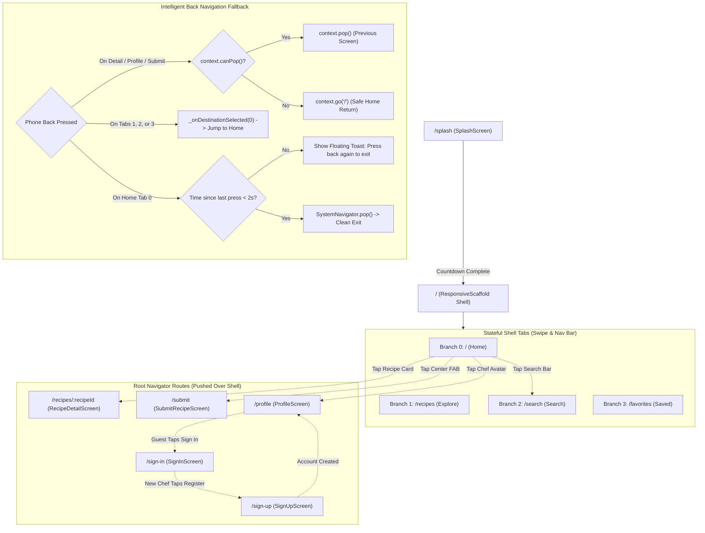
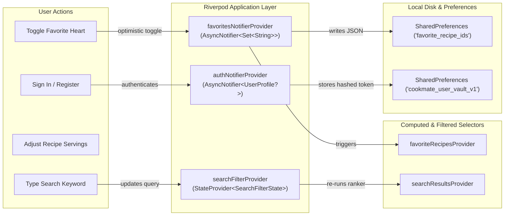
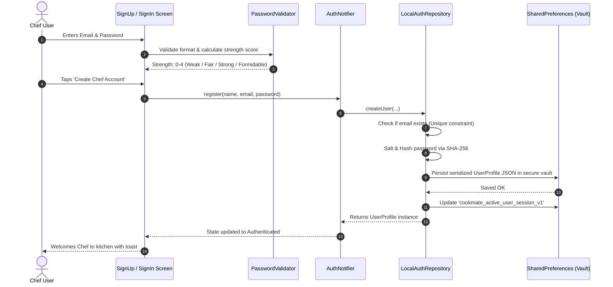
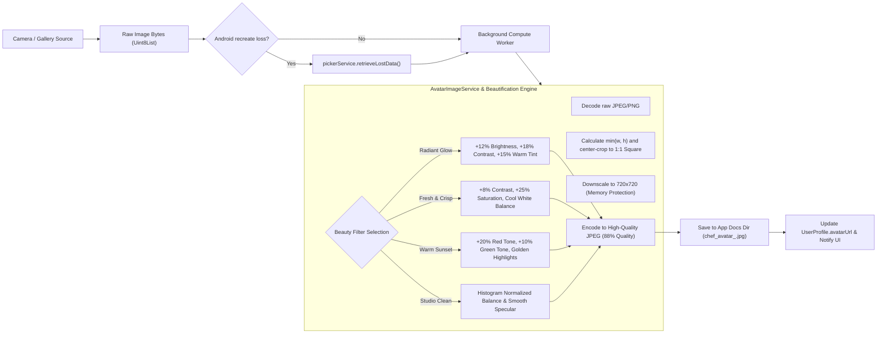
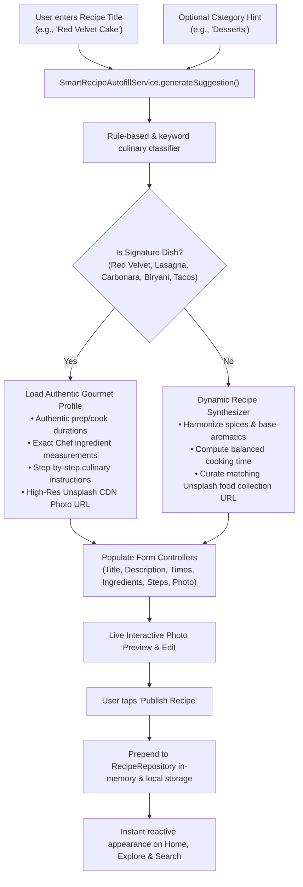
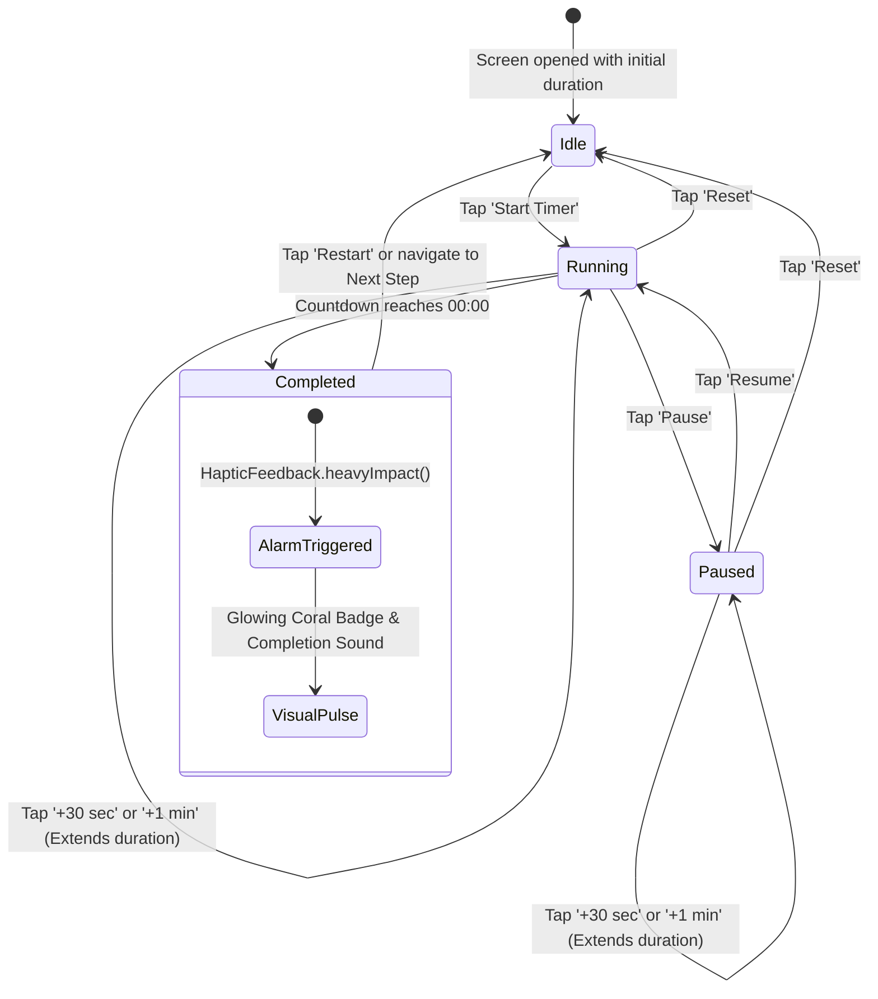

# 🏛️ CookMate — Architectural Specification & Engineering Blueprint

> **CookMate** is an offline-first, luxury editorial culinary discovery and companion mobile application engineered with Flutter, Dart, Riverpod, and Material Design 3.

---

## 📑 Table of Contents
1. [Architectural Overview & Core Principles](#1-architectural-overview--core-principles)
2. [System Architecture Diagram](#2-system-architecture-diagram)
3. [Navigation Hierarchy & PopScope Routing](#3-navigation-hierarchy--popscope-routing)
4. [State Management & Data Flow (Riverpod)](#4-state-management--data-flow-riverpod)
5. [Authentication & Cryptographic Vault](#5-authentication--cryptographic-vault)
6. [Photo Processing & Beauty Engine](#6-photo-processing--beauty-engine)
7. [Chef AI Recipe Synthesis & Autofill Pipeline](#7-chef-ai-recipe-synthesis--autofill-pipeline)
8. [Synchronized Cooking Timer State Machine](#8-synchronized-cooking-timer-state-machine)
9. [Responsive Layout & Cross-Device Strategy](#9-responsive-layout--cross-device-strategy)
10. [Folder & Package Structure](#10-folder--package-structure)

---

## 1. Architectural Overview & Core Principles

CookMate follows **Feature-First Clean Architecture** with strict layer separation, deterministic dependency injection, and unidirectional reactive state flow.

```
┌──────────────────────────────────────────────────────────────┐
│                    Presentation Layer                        │
│  (Widgets, Screens, Slivers, Animations, Glass Surfaces)     │
└──────────────────────────────┬───────────────────────────────┘
                               │ Watches / Listens
                               ▼
┌──────────────────────────────────────────────────────────────┐
│                     Application Layer                        │
│      (Riverpod Notifiers, StateProviders, Selectors)         │
└──────────────────────────────┬───────────────────────────────┘
                               │ Invokes / Orchestrates
                               ▼
┌──────────────────────────────────────────────────────────────┐
│                       Domain Layer                           │
│ (Entities, Models, Pure Business Logic, Scalers, Validators) │
└──────────────────────────────┬───────────────────────────────┘
                               │ Implements Interfaces
                               ▼
┌──────────────────────────────────────────────────────────────┐
│                        Data Layer                            │
│  (Repositories, SharedPreferences, JSON Assets, Vault, GCS)  │
└──────────────────────────────────────────────────────────────┘
```

### Core Engineering Invariants:
1. **Offline-First Resilience**: All core capabilities—recipe exploration, multi-criteria search, ingredients scaling, cooking timers, chef registration, and local community submissions—function seamlessly without an active internet connection.
2. **Unidirectional Data Flow**: State flows downward from Riverpod providers to presentation widgets; user events trigger methods on Notifiers, which mutate state immutably.
3. **Defensive Layout Constraints**: Every viewport orientation (portrait, compact landscape, tablet, desktop) enforces bounded constraints (`LayoutBuilder`, `SingleChildScrollView`, `ConstrainedBox`), guaranteeing **0 pixel overflow** under all form factors.
4. **Guaranteed Back Navigation**: Every route and nested shell utilizes Flutter 3.22+ `PopScope` handlers with intelligent fallbacks (`context.canPop() ? context.pop() : context.go('/')`) and an accidental-exit prevention toast on Home.

---

## 2. System Architecture Diagram

```mermaid
graph TD
    subgraph UI ["Presentation Layer (Flutter 3.22+)"]
        Home["HomeScreen (Discovery & Hero Deck)"]
        Explore["ExploreScreen (Categorized Grid)"]
        Search["SearchScreen (Prefix & Accent Match)"]
        Saved["FavoritesScreen (Saved Recipes)"]
        Detail["RecipeDetailScreen (Scaling & Steps)"]
        TimerSheet["CookingTimerSheet (Synchronized Timer)"]
        Profile["ProfileScreen (Chef Identity & Vault)"]
        Auth["SignInScreen / SignUpScreen"]
        Submit["SubmitRecipeScreen (AI Auto-Fill)"]
    end

    subgraph State ["Application & State Layer (Riverpod)"]
        AllRecProv["allRecipesProvider"]
        SearchProv["searchFilterProvider & searchResultsProvider"]
        FavNotifier["favoritesNotifierProvider"]
        AuthNotifier["authNotifierProvider"]
        ThemeProv["themeModeProvider"]
        DetailProv["recipeDetailProvider(id)"]
    end

    subgraph Domain ["Domain Layer (Business Logic)"]
        RecipeModel["Recipe Model & Scaler"]
        SearchEngine["RecipeSearchEngine (Levenshtein + Prefix)"]
        AutofillService["SmartRecipeAutofillService"]
        AvatarService["AvatarImageService (Cropper & Filters)"]
        AuthValidator["PasswordValidator & EmailValidator"]
    end

    subgraph Data ["Data Layer & Local Vault"]
        JsonSeed["LocalJsonRecipeDataSource (recipes.json)"]
        RecipeRepo["DefaultRecipeRepository"]
        FavRepo["LocalFavoritesRepository (Prefs)"]
        AuthRepo["LocalAuthRepository (SHA-256 Vault)"]
        DiskStore["App Document Storage (Avatars & Drafts)"]
    end

    Home --> AllRecProv
    Home --> ThemeProv
    Explore --> AllRecProv
    Search --> SearchProv
    Saved --> FavNotifier
    Detail --> DetailProv
    Detail --> TimerSheet
    Profile --> AuthNotifier
    Auth --> AuthNotifier
    Submit --> AutofillService

    AllRecProv --> RecipeRepo
    SearchProv --> SearchEngine
    FavNotifier --> FavRepo
    AuthNotifier --> AuthRepo
    DetailProv --> RecipeRepo

    RecipeRepo --> JsonSeed
    RecipeRepo --> DiskStore
    FavRepo --> DiskStore
    AuthRepo --> DiskStore
    AvatarService --> DiskStore
```



---

## 3. Navigation Hierarchy & PopScope Routing

CookMate utilizes **GoRouter** with a persistent `StatefulShellRoute` for seamless branch transitions and standalone root navigator routes for detailed flows.



---

## 4. State Management & Data Flow (Riverpod)

State management in CookMate is strictly reactive, asynchronous, and memory-safe.



---

## 5. Authentication & Cryptographic Vault

CookMate incorporates a local hashed security vault simulating bank-grade authentication with zero network dependencies.



---

## 6. Photo Processing & Beauty Engine

When updating their Chef Portrait, users can capture a fresh selfie via the front camera or choose an existing portrait from their phone gallery. The image is processed through an automated background image manipulation pipeline.



---

## 7. Chef AI Recipe Synthesis & Autofill Pipeline

When sharing a new kitchen creation, CookMate's **Chef AI Auto-Fill Engine** automatically analyzes the dish title and category, generating complete culinary specifications and fetching verified authentic photography from Unsplash.



---

## 8. Synchronized Cooking Timer State Machine

Cooking Mode provides an interactive step-by-step workflow with real-time timers synchronized to each cooking instruction.



---

## 9. Responsive Layout & Cross-Device Strategy

CookMate guarantees zero pixel overflows across all screen sizes and rotation angles:

| Form Factor | Screen Width / Height | Adaptive Component |
|---|---|---|
| **Mobile Portrait** | `width < 480px` | Translucent Liquid-Glass bottom navigation bar, single-column sliver lists, stacked metric rows. |
| **Compact Landscape** | `width >= 480px` & `height < 500px` | Side `NavigationRail` wrapped in scrollable `LayoutBuilder` with compact icons, preventing vertical overflow. |
| **Tablet / Desktop** | `width >= 840px` | Expanded `NavigationRail` with persistent labels, multi-column grid (`SliverGridDelegateWithMaxCrossAxisExtent: 280`), and centered content bounded by `maxContentWidth: 1200px`. |

---

## 10. Folder & Package Structure

```
c:\Users\khero\StudioProjects\CookMate\
├── assets/
│   ├── data/
│   │   └── recipes.json                     # Seed catalogue of 15 gourmet recipes
│   └── images/
│       ├── app_logo.png                     # Transparent 3D chef logo badge
│       └── splash_preview.png               # High-res splash illustration
├── lib/
│   ├── main.dart                            # Application entry point with ProviderScope
│   ├── app/
│   │   ├── app.dart                         # MaterialApp.router with Theme configuration
│   │   └── router.dart                      # GoRouter StatefulShellRoute & route transitions
│   ├── core/
│   │   ├── constants/
│   │   │   └── app_constants.dart           # Categories, breakpoints, shared pref keys
│   │   └── theme/
│   │       ├── app_colors.dart              # Gourmet color palette (Forest Green, Citrus Lime, etc.)
│   │       └── app_theme.dart               # Material 3 light/dark ThemeData & typography
│   ├── features/
│   │   ├── auth/                            # Authentication & Chef Profile feature
│   │   │   ├── data/repositories/           # LocalAuthRepository (SHA-256 hashed vault)
│   │   │   ├── domain/
│   │   │   │   ├── models/user_profile.dart # UserProfile entity
│   │   │   │   └── services/                # AvatarImageService & PasswordValidator
│   │   │   └── presentation/                # ProfileScreen, SignInScreen, SignUpScreen
│   │   ├── favorites/                       # Saved recipes bookmarking feature
│   │   ├── home/                            # Discovery screen & hero carousel
│   │   ├── recipes/                         # Catalog, details, scaling & search features
│   │   │   ├── domain/services/             # RecipeScaler & RecipeSearchEngine
│   │   │   └── presentation/screens/        # ExploreScreen & RecipeDetailScreen
│   │   ├── search/                          # Real-time search with query params
│   │   ├── splash/                          # 3D logo physics splash screen
│   │   └── submission/                      # Recipe submission & Smart Autofill feature
│   └── shared/
│       └── widgets/                         # Reusable UI components: GlassCard, BounceTap,
│                                            # ChefPickDeck, AppLogoBadge, CookingTimerSheet
└── test/
    ├── unit/                                # Unit tests: scaling, search, auth, autofill, filters
    ├── widget_test.dart                     # UI & responsiveness widget tests
    └── widget_timer_test.dart               # Cooking timer sheet widget tests
```
