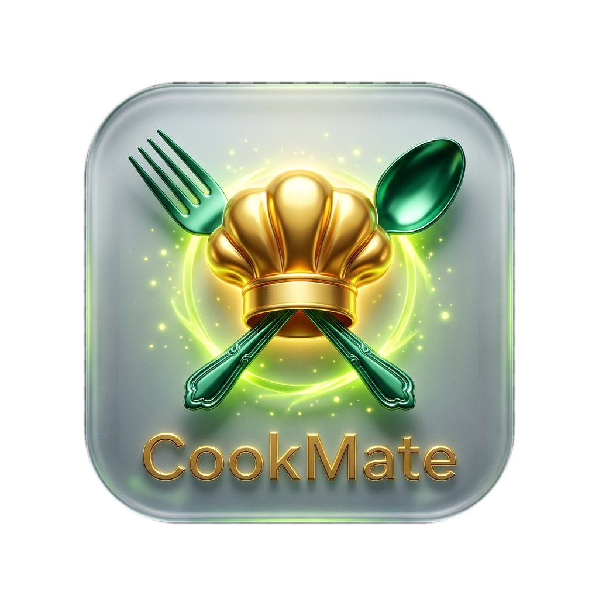
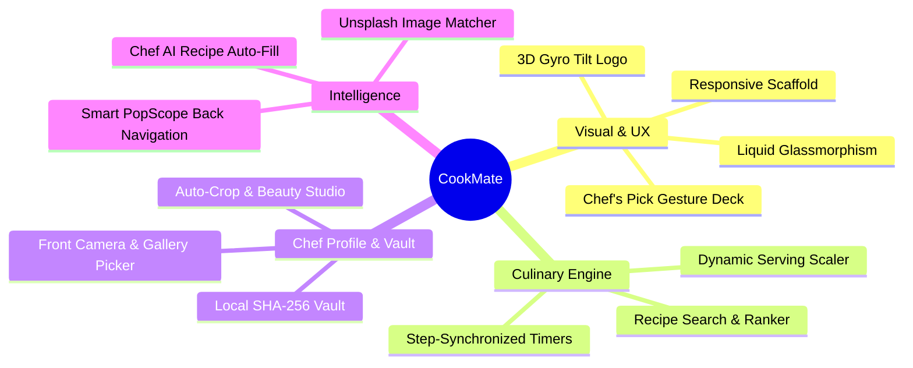
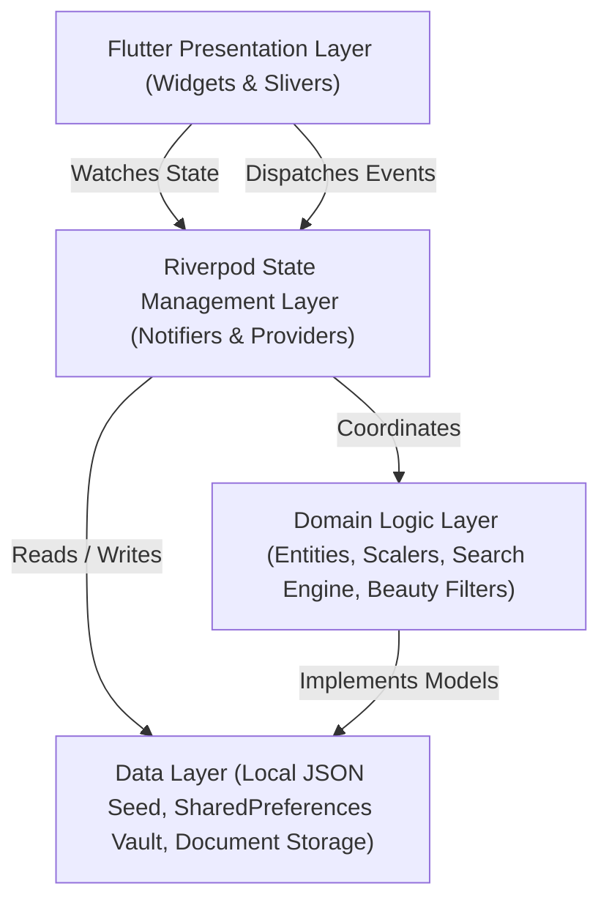

<p align="center">
  
</p>

<h1 align="center">🍲 CookMate — Your Master Kitchen Companion</h1>

<p align="center">
  <strong>A Luxury Editorial Offline-First Culinary Discovery & Cooking Companion Application</strong>
</p>

<p align="center">
  <a href="https://flutter.dev"></a>
  <a href="https://dart.dev"></a>
  <a href="https://pub.dev/packages/flutter_riverpod"></a>
  <a href="https://pub.dev/packages/go_router"></a>
  
  
  <a href="LICENSE"></a>
</p>

---

## 📖 Executive Summary

**CookMate** is an offline-first, editorial culinary companion designed to elevate home cooking into a fine-dining experience. Crafted with **Material Design 3**, **Liquid Glassmorphism**, and **Riverpod** state management, CookMate pairs fluid physics with intelligent culinary utilities: dynamic ingredient scaling, synchronized kitchen timers, local cryptographic user vault, AI recipe auto-fill, and a front-camera portrait beauty studio.

---

## ✨ Highlights & Key Innovations



### 1. 🎨 Liquid Glassmorphism & Gourmet Palette
* **Frosted Translucent Surfaces**: `BackdropFilter` Gaussian blur with specular hairline borders, ambient glows, and floating liquid cards.
* **Gourmet Color Palette**:
  * 🌲 **Forest Green** (`#173D31`) &mdash; Organic base
  * 🌾 **Warm Cream** (`#F8F4EA`) &mdash; Editorial paper surface
  * 🍋 **Citrus Lime** (`#D8F078`) &mdash; High-energy accent
  * 🍉 **Soft Coral** (`#F18C72`) &mdash; Warm heart and alert highlights
  * 🌑 **Deep Emerald Surface** (`#12251F`) &mdash; Rich OLED dark mode

### 2. 🎴 Chef's Pick 3D Interactive Deck (`ChefPickDeck`)
* Multi-card stacking deck with smooth spring physics, rotation dampening, and velocity-sensitive dismiss gestures.
* Swipe left or right with instant haptic feedback to cycle through featured dishes.

### 3. 🔍 Intelligent Recipe Search Engine
* **Accent-Insensitive & Diacritic-Agnostic**: Matches `creme brulee` as accurately as `crème brûlée`.
* **Incremental Prefix Search**: Real-time multi-token keyword ranking prioritizing exact title matches over ingredients and tags.
* **Deep-Link Query Synchronization**: Supports direct URL navigation via `/search?q=pasta`.

### 4. ⚖️ Interactive Serving Scaler & Checkable Ingredients
* Automatically scales rational quantities, unit fractions (e.g., `1/2 cup` to `1 cup`), and complex package formats (e.g., `2 × 200g Wagyu`).
* Interactive checkable ingredient list with animated strikethrough styling to track prep work in the kitchen.

### 5. ⏱️ Synchronized Cooking Mode & Countdown Kitchen Timer
* Step-by-step cooking sheet with individual instruction progress.
* **Synchronized Step Timers**: Automatically parses duration text from steps (e.g., *"Simmer for 15 minutes"* &rarr; 15:00 timer).
* Real-time timer with Pause, Resume, Reset, +30s, and +1m quick-adjust controls.
* Zero pixel overflow guarantee across all compact mobile screens.

### 6. 🔐 Chef Profile & Local Cryptographic Vault
* Complete local authentication system with salt-hashed SHA-256 password security.
* Guest Chef gateway with Remember Me support, password strength indicators (Weak to Formidable), and secure local account recovery.
* Live recipe submission counts and personalized "My Kitchen Creations" showcase.

### 7. 📸 Front Camera & Gallery Photo Studio with Beauty Filters
* Take front-camera selfies or pick portraits directly from the phone photo gallery.
* Automatic square center-cropping (1:1 ratio) and auto-orientation correction.
* **Chef Beauty Studio**: Select from 4 real-time filters:
  * 🌟 **Radiant Glow** &mdash; Soft lighting with balanced warm luminosity.
  * 🌿 **Fresh & Crisp** &mdash; Vivid contrast and clean white balance.
  * 🌅 **Warm Sunset** &mdash; Golden undertones for cozy warmth.
  * 💎 **Studio Clean** &mdash; High-definition studio portrait clarity.
* Resilient recovery against Android OS activity recreations.

### 8. 🧑‍🍳 Chef AI Recipe Auto-Fill Engine
* Enter a dish title (e.g., *"Red Velvet Cake"*) and category to trigger Chef AI synthesis.
* Automatically generates authentic prep/cook times, chef-grade ingredient measurements, numbered instructions, and authentic high-resolution Unsplash food photography URLs.
* Prepend newly created recipes immediately to Home, Explore, and Search feeds.

### 9. 🛡️ System-Wide Smart Back Navigation (`PopScope`)
* Intelligent hardware and gesture back button handling across every screen in the application.
* Smoothly switches tabs back to Home (tab 0) when pressing back on Explore, Search, or Saved.
* **Double-Back-to-Exit Guard**: Shows a floating toast (*"Press back again to exit CookMate"*) on Home to prevent accidental closures.
* Comprehensive route fallbacks guarantee users are never trapped on nested screens.

### 10. 📐 Adaptive Responsive Scaffolding
* **Mobile Portrait**: Liquid-glass floating bottom navigation bar.
* **Compact Landscape**: Side `NavigationRail` wrapped in scrollable bounded constraints with auto-collapsing icons, eliminating `RenderFlex` overflow during phone tilt.
* **Tablet & Desktop**: Multi-column editorial grid with max-content boundary (`1200px`).

---

## 🏗️ System Architecture



For the complete architectural blueprint and detailed data flow diagrams, see [ARCHITECTURE.md](ARCHITECTURE.md).

---

## 📂 Project Structure

```
CookMate/
├── android/                                 # Native Android wrapper and Gradle configuration
├── assets/
│   ├── data/
│   │   └── recipes.json                     # Seed catalogue of 15 gourmet recipes
│   └── images/
│       ├── app_logo.png                     # Transparent 3D chef logo badge
│       └── splash_preview.png               # High-res splash illustration
├── lib/
│   ├── main.dart                            # Entry point with ProviderScope initialization
│   ├── app/
│   │   ├── app.dart                         # MaterialApp.router configuration
│   │   └── router.dart                      # GoRouter StatefulShellRoute & route transitions
│   ├── core/
│   │   ├── constants/                       # AppConstants (categories, breakpoints, keys)
│   │   └── theme/                           # AppColors & AppTheme (Material 3 themes)
│   ├── features/
│   │   ├── auth/                            # Chef Auth & Profile (Vault & Beauty Studio)
│   │   ├── favorites/                       # Saved Recipes & Bookmark Notifiers
│   │   ├── home/                            # Home screen & Chef's Pick 3D Deck
│   │   ├── recipes/                         # Explore, Detail, Scaling & Search logic
│   │   ├── search/                          # Find a Dish screen & query synchronization
│   │   ├── splash/                          # 3D logo physics splash screen
│   │   └── submission/                      # Share a Recipe form & Chef AI Auto-Fill
│   └── shared/
│       └── widgets/                         # Reusable GlassCards, BounceTap, Timers, Badges
├── test/
│   ├── unit/                                # Comprehensive unit tests (Auth, Scaler, Search, Filters)
│   ├── widget_test.dart                     # UI & Responsive orientation tests
│   └── widget_timer_test.dart               # Cooking timer sheet tests
├── pubspec.yaml                             # Package dependencies & asset declarations
├── ARCHITECTURE.md                          # Detailed architectural specification
└── README.md                                # Project documentation
```

---

## 🚀 Getting Started

### Prerequisites
* [Flutter SDK](https://flutter.dev/docs/get-started/install) (`^3.22.0` or later)
* [Dart SDK](https://dart.dev/get-dart) (`^3.4.0` or later)
* Android Studio / Xcode / VS Code with Flutter extension
* An Android device or emulator (API 24+)

### Installation & Run

1. **Clone the repository**:
   ```bash
   git clone https://github.com/AbdullahAzeem12/CookMate.git
   cd CookMate
   ```

2. **Install dependencies**:
   ```bash
   flutter pub get
   ```

3. **Verify static analysis**:
   ```bash
   flutter analyze
   ```

4. **Run automated test suite**:
   ```bash
   flutter test
   ```

5. **Launch CookMate on your connected device**:
   ```bash
   flutter run
   ```

---

## 🧪 Automated Testing & Code Verification

CookMate is backed by **61 passing automated tests** across unit, domain, repository, and widget layers:

```bash
$ flutter test
00:19 +61: All tests passed!
```

* **Unit & Domain Tests**:
  * `auth_system_test.dart`: Validates email formats, password strength algorithms, SHA-256 vault encryption, duplicate rejection, and session persistence.
  * `avatar_processor_test.dart`: Validates 1:1 square center-cropping, beauty filter transforms, and compute worker safety.
  * `recipe_scaler_test.dart`: Validates serving scaling, vulgar fractions, and multi-token unit preservation.
  * `recipe_search_engine_test.dart`: Validates diacritic normalization, prefix matching, and multi-criteria sorting.
  * `smart_recipe_autofill_test.dart`: Validates Chef AI signature dish recognition, instruction generation, and Unsplash URL mapping.
* **Widget & Integration Tests**:
  * `widget_test.dart`: Verifies responsive phone tilt transitions, gesture deck physics, and navigation flows.
  * `widget_timer_test.dart`: Verifies synchronous cooking timer sheet rendering with zero pixel overflows.

---

## 📄 License

This project is licensed under the MIT License &mdash; see the [LICENSE](LICENSE) file for details.

---

<p align="center">
  Crafted with passion by <strong>Abdullah Azeem</strong> 👨‍🍳✨
</p>
